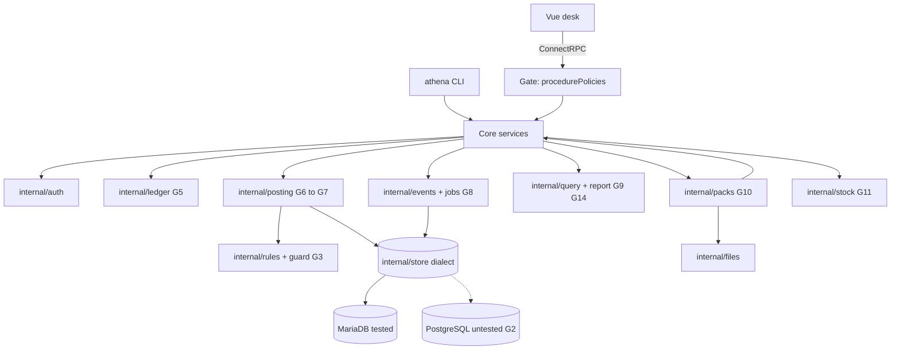
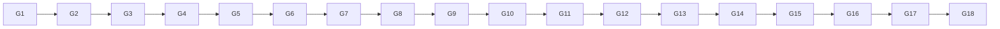

# Design Document

## Overview

Batch 2 extends the committed kernel (P0 to P9, P8a) in eighteen ordered groups. G1 to G4 harden access, the database seam, Rules and the Record Type publisher. G5 to G7 add the ledger foundation, the posting engine and the party ledger. G8 adds the durable event and job layer that G9 to G18 depend on. G9 to G15 complete reporting, Packs, stock, the remaining ledgers, trees, the report engine and the integration surface. G16 adds offline counts. G17 and G18 ship business, industry and channel behaviour as Packs, not as core seeds.

Design rules that apply to every group:

- **Extend before create.** Each group names the existing files it edits. A new package or file appears only where no existing one covers the job, and the task list says which.
- **One write path.** Desk, CLI, importers, jobs and provider adapters call the same Go services. The CLI calls Go packages directly, as `cmd/athena/access.go` does today, and adds no HTTP endpoint.
- **Gate first.** Every new ConnectRPC procedure gets a `procedurePolicies` entry in `internal/server/gate.go`. `TestEveryProcedureHasAPolicy` is the check.
- **Migrations are append-only.** New entries are added to `server.SystemMigrations()` in `internal/server/sysmigrations.go`, numbered from 12.
- **Telemetry stays optional.** New spans carry ids, counts, durations and outcome codes. They never carry Record values, amounts, party ids, passwords, tokens or Challenge values.
- **MariaDB is the only tested database.** PostgreSQL code in G2 is implemented but untested, and no later group claims parity.

### Reordering and boundary decisions

| Decision | Reason | Source |
| --- | --- | --- |
| G8 (roadmap P16) runs before G9 (roadmap P14) | Report schedules and delivery need leases, outbox and unique occurrence keys | user constraint 3, PB §4 |
| Settings with scope chains sit in G5 | They need Company and Branch | IO §4 |
| Secret references, key custody and Record lifetimes sit in G8 | Disposal and credential delivery need jobs and the outbox | IO §2, §3 |
| Account, Account Type and Account Determination are kernel-provisioned in G5 | Ledger rows must reference valid accounts; ADR-0021 records the boundary against D-007 | user constraint 3, RD P11 |
| Business starter, industry and channel behaviour ships as Packs | Keeps D-007: no domain Record Types in the platform shell | AGENTS.md |

### Research summary

The design follows the six revamp docs and the kernel specification. The findings that shape it:

- Posting is one transaction: voucher revision, ledger rows, balance deltas, audit, operation result and outbox row (PB §2).
- Historical valuation rows are never rewritten. Cost corrections append deltas (RA P0).
- Access evaluates whole Assignments, not a union of all actions and all Scopes (PB §3 counterexample).
- The outbox pattern gives at-least-once delivery, so every consumer needs its own inbox row and effect key (PE §5, [AWS transactional outbox guidance](https://docs.aws.amazon.com/prescriptive-guidance/latest/cloud-design-patterns/transactional-outbox.html)).
- A Starlark instruction budget does not bound a Go builtin that allocates, so the host must cap sizes itself (PB §2, ADR-0016). The standard Go implementation is [starlark-go](https://github.com/google/starlark-go).
- Content was rephrased for compliance with licensing restrictions.

## Architecture

Group dependency order:

## Components and Interfaces

### Group map to existing code

| Group | Existing files extended | New packages or files (only where none fits) | Proto and procedures | Migration | ADR |
| --- | --- | --- | --- | --- | --- |
| G1 Access | `internal/auth/{principal,service,accesslog,password}.go`, `internal/server/{auth_rpc,access,gate}.go`, `proto/athena/v1/auth.proto`, `cmd/athena/access.go`, `web/src/{App.vue,api.ts,types.ts,components/ChangePasswordDialog.vue}` | `internal/auth/{challenge,assignment,explain}.go`, `web/src/pages/AccessPage.vue` and its components (no existing page covers it) | Extend `AuthService`: `InviteUser`, `CompleteChallenge`, `ResendInvite`, `StartReset`, `ListAssignments`, `SaveAssignment`, `RevokeAssignment`, `ExplainAccess`, `ListSessions`, `RevokeSession`, `TransferOwnership` | 12 `access_model` | 0017, amends 0014 |
| G2 PostgreSQL | `internal/store/{store,migrate}.go`, `internal/server/server.go` (driver switch), `internal/workspace/{workspace,templates}.go`, `cmd/athena/main.go` help | `internal/store/postgres.go`, `postgres_test.go` | none | none | 0018, amends 0005 and 0002 |
| G3 Guard | `internal/rules/{rules,builtins,value}.go`, `internal/server/{rules,rules_engine}.go` | none | none | none | 0019, amends 0016 |
| G4 Atomic save | `internal/server/{record_types,records}.go`, `proto/athena/v1/record_types.proto` (`SaveRecordTypeRequest.parent`), `web/src/App.vue` | none | extend `RecordTypeService.SaveRecordType` | none | 0020 |
| G5 Ledger foundation | `internal/server/{kinds,kind_migration,sysmigrations,gate}.go`, `internal/store/store.go` | `internal/ledger/`, `proto/athena/v1/ledger.proto`, `cmd/athena/ledger.go`, `web/src/pages/LedgerSetupPage.vue` | new `LedgerService` (setup, Settings) | 13 `ledger_foundation` | 0021 |
| G6 Posting | `internal/rules` (Posting type), `internal/lifecycle/lifecycle.go` (`on_submit`, `on_cancel`), `internal/server/lifecycle.go`, `internal/audit/audit.go`, `internal/types/{money,allocate}.go` | `internal/posting/`, `cmd/athena/post.go`, voucher drill page in `web/src/pages/RecordsPage.vue` (edit) | `LedgerService`: `PreviewPosting`, `GetPostingStatus`, `ListPostingLog`, `ListLedgerRows` (read only) | 14 `posting_engine` | 0022 |
| G7 Party ledger | `internal/posting`, `internal/types/allocate.go` | `internal/posting/settlement.go`, `cmd/athena/settle.go` | `LedgerService`: `ApplySettlement`, `ReverseSettlement`, `ListOpenItems` | 15 `party_ledger` | 0023 |
| G8 Events and jobs | `internal/server/server.go` (worker start), `internal/lifecycle`, `internal/auth` (delivery), `internal/audit` | `internal/events/`, `internal/jobs/`, `internal/secrets/`, `proto/athena/v1/events.proto`, `proto/athena/v1/settings.proto`, `cmd/athena/{jobs,events,secrets}.go`, `web/src/pages/{JobsPage,SettingsPage}.vue` | `EventService`, `JobService`, `WorkflowService`, `SecretService`, `RetentionService` | 16 `events_jobs_secrets` | 0024, 0025 |
| G9 Reports v1 | `internal/posting` (Balance deltas), `internal/auth/principal.go` (Scope to predicate), `internal/expr` (SQL translation) | `internal/query/`, `internal/report/`, `proto/athena/v1/reports.proto`, `cmd/athena/report.go`, `web/src/pages/ReportsPage.vue` | `ReportService` | 17 `balances_reports` | 0026 |
| G10 Packs | `internal/workspace/templates.go`, `internal/files`, `internal/server/server.go`, `web/src/pages/PacksPage.vue` | `internal/packs/`, `proto/athena/v1/packs.proto`, `cmd/athena/pack.go` | `PackService` | 18 `packs` | 0027 |
| G11 Stock | `internal/posting`, `internal/types/quantity.go` | `internal/stock/`, `proto/athena/v1/stock.proto`, `cmd/athena/stock.go` | `StockService` | 19 `stock_ledger` | 0028 |
| G12 Ledgers | `internal/ledger`, `internal/posting` | `internal/ledger/{tax,asset,budget,project,leave,meter,intercompany}.go` | extend `LedgerService.ListLedgerRows` | 20 `remaining_ledgers` | 0029 |
| G13 Trees, UoM | `internal/server/{records,record_types,migrations}.go`, `internal/store`, `internal/types/quantity.go` | `internal/ledger/determination.go` (specificity) | extend `RecordTypeService` attributes `tree`, `effective_dated` | 21 `trees_effective_uom` | 0030 |
| G14 Report engine | `internal/report`, `internal/jobs` | `internal/report/{schedule,closingpack,explain}.go`, `web/src/pages/WorkQueuePage.vue` | extend `ReportService`; add `ExplainService` method `ExplainMovement` | 22 `report_engine` | 0031 |
| G15 Integrations | `internal/files` (blob), `internal/server/gate.go`, `internal/store` (search) | `internal/integrations/`, `proto/athena/v1/integrations.proto`, `cmd/athena/{inbox,attachments}.go` | `IntegrationService` | 23 `integrations` | 0032 |
| G16 PWA | `web/vite.config.ts`, `web/index.html`, `web/src/main.ts`, `internal/webui` (serve manifest and worker headers) | `web/src/offline/` (queue, store), `proto/athena/v1/sync.proto`, `internal/server/sync.go` | `SyncService` | 24 `offline_sync` | 0033 |
| G17 Business starter | `internal/workspace/{create,templates}.go`, `internal/packs`, `web/src/pages/{OverviewPage,PacksPage}.vue`, `cmd/athena/main.go` | `packs/` (Pack sources in the repository) and `cmd/athena/setup.go`, `web/src/pages/SetupPage.vue` | `PackService` readiness methods | 25 `setup_readiness` | 0034 |
| G18 Industry Packs | `packs/` | one directory per Pack under `packs/` | none expected beyond `PackService` | none expected (Pack tables come from the Publisher) | 0035 |

Migration numbers 12 to 25 follow the last applied number, 11, and are assigned in group order. Groups G2, G3 and G4 need none, so the sequence stays contiguous.

### G1 Access model

Existing: `Principal.Owner` grants everything (`principal.go`); `athena_user_roles` links users to Roles with no Scope or dates; `CreateUserRequest.password` and `ResetPasswordRequest.new_password` set passwords.

Changes:

- **Challenges.** `internal/auth/challenge.go` issues 128-bit random tokens, stores SHA-256 digests in `athena_challenges (id, user_id, purpose, digest, generation, expires_at, consumed_at, attempts)`. Consumption is a single `UPDATE ... WHERE consumed_at IS NULL AND generation = ?` checked by rows affected, so two concurrent completions yield one success. Purposes: `first_login`, `reset`, `activation`. Activation codes are short, rate-limited and shown once.
- **User state.** `athena_users` gains `state` (`invited`, `active`, `reset_required`, `suspended`), `generation`, nullable `password_hash` and `invite_delivery`. Existing rows migrate to `active`.
- **Assignments.** `athena_user_roles` is replaced by `athena_role_assignments (id, user_id, role_id, scope JSON, active_from, expires_at, revision)`. Existing rows copy over with empty Scope and no dates, so current access is unchanged.
- **Scope dimensions.** A Record Type field can declare `scope_dimension` (for example `company`). A Role lists `requires_scope` dimensions. An empty required Scope denies.
- **Protected capabilities.** New system permissions `access:ownership`, `access:users`, `access:roles`, `access:assign`, `access:recover`, `access:sessions`, `access:explore` replace the single `access` permission. Migration 12 maps each existing `access` holder to all but `access:ownership`. The `is_owner` flag remains only as the marker for the Instance Owner Role and no longer short-circuits `HasSystem`, `Can`, `Level`, `Scope` or `MustSeparateDuties`.
- **Evaluation.** `Principal` carries `Assignments []Assignment`. `Can(recordType, action, row)` returns true when one whole active Assignment has a covering Grant, a true row condition and a matching Scope. `Scope(recordType, action)` returns a list of disjuncts (condition AND Scope predicate), one per matching Assignment. `internal/server/access.go` compiles the disjunct list through the existing expression-to-SQL path.
- **Last-owner guard.** One transaction takes `SELECT ... FOR UPDATE` on all active owner assignments, applies the change, counts the remaining active verified owners and rolls back at zero.
- **System Roles.** Platform Administrator (Build, Rules, Files, no business grants), Instance Owner (ownership, users, assign, recover, no business or Build), System Manager (users, roles, assign, sessions). Business Role templates are created without Grants; Packs add Grants through templates (G10).
- **Bootstrap.** `athena new` creates the first owner through a one-use setup that fails if an owner exists. OPEN: whether the local first owner also receives an explicit, removable Platform Administrator Assignment so Build stays reachable on a single-user Workspace.
- **Explorer.** `internal/auth/explain.go` returns, per Assignment, the failing condition (grant, condition, scope, dates, field level) for `ExplainAccess`.
- **Desk.** `AccessPage.vue` has Users, Roles and Sessions tabs, Role chips with Scope pickers, active-from and expiry date inputs, a preview and diff dialog, and a Permission Explorer panel. It uses existing shadcn-vue components (`dialog`, `tabs`, `table`, `badge`, `select`, `checkbox`, `popover`, `command`) and Sonner toasts.
- **Proto.** In `auth.proto`, `CreateUserRequest` marks field 3 and name `password` reserved. `ResetPasswordRequest` marks field 2 and name `new_password` reserved. `ChangePassword` remains for self-service.

### G2 PostgreSQL

`internal/store/postgres.go` implements every `Dialect` method: double-quoted lowercase identifiers, 63-byte shortening with a hash suffix, `JSONB`, `TIMESTAMPTZ`, `INSERT ... ON CONFLICT`, `FOR UPDATE`, `pg_advisory_lock`, and error classification by SQLSTATE. The pgx stdlib driver wraps with `otelsql` the same way `server.go` wraps the MySQL driver. Tests assert SQL strings only. Docs say "implemented but untested".

### G3 Resource guard

`rules.Limits` gains `MaxStringLen`, `MaxCollectionLen`, `MaxValues`, `MaxRowsPerRead` and `MaxCascadeDepth`. The host wraps every builtin that builds a value (`builtins.go`) and counts values built. A Starlark `Thread` print and size hooks cannot see `[0] * N`, so the host also rejects the multiplication case through a precheck on the Rule's AST (a static restriction on repeat operators with a non-literal or large factor) and runs a size check after each builtin. The outcome codes `memory_limit`, `row_limit` and `cascade_limit` are added next to `CodeStepLimit`. Simulate and saved runs use one limits value.

### G4 Atomic pair save

`SaveRecordTypeRequest` already carries the child; the request adds the parent definition and expected revision. `Publisher` begins one journal operation of kind `save_group` listing both members, applies the child then the parent under the schema lock, and records a step per member. On failure it runs the recorded inverse for completed members (drop added columns, restore metadata), or at startup `resumeOperations` rolls the group back or forward from the journal. DDL commits implicitly on MariaDB, so the guarantee is compensation, not a single transaction. ADR-0020 says so.

### G5 Ledger foundation

`internal/ledger` owns Company, Branch, Department, Cost Centre, Dimension Definition, Fiscal Year, Accounting Period, Currency, Exchange Rate, Account Type, Account, Account Determination and Settings. They are kernel-provisioned Record Types of kind `meta`, `master` or `setting` stored in `athena_` system tables, created by migration 13 and registered so the Desk lists them in Build. `kinds.go` `kernelKinds` (`ledger`, `balance`, `log`, `snapshot`, `meta`) becomes writable only through the owning service. Direct inserts through `RecordService` for ledger-kind tables are rejected by a kind check in `records.go`. Settings resolution is a pure function `Resolve(key, scopeChain, at, revision)` in `internal/ledger/settings.go`.

### G6 Posting engine

`internal/posting` exposes `Preview(ctx, voucher)` and `Post(ctx, tx, voucher, operationID)`. Lifecycle hooks in `internal/lifecycle/lifecycle.go` call `Post` in `on_submit` and the mirror in `on_cancel`. The engine runs the posting Rule in `internal/rules` with the Posting rule type, validates the plan, then writes in one transaction. `athena_operations (workspace, actor, command, operation_id, payload_hash, result, created_at)` has a unique key on (actor, command, operation_id). `athena_posting_groups` has a unique key on (voucher_type, voucher_id, revision, event, book). The Posting_Log is a Log Record Type written after rollback by a separate connection so failed attempts stay visible.

### G7 Party ledger

`athena_party_items` (open items per instalment) and `athena_settlement_applications` (append-only, both endpoints, currency amounts, base amount, reversal id). `types.Allocate` distributes a payment across instalments in a stable order. Realised FX is posted as a plan through G6.

### G8 Events, jobs, workflows, secrets, lifetimes

`internal/events` writes `athena_events` and `athena_outbox` in the producer transaction and keeps `athena_inbox (consumer, event_id, effect_key, result)`. `internal/jobs` leases rows from `athena_jobs` with an expiry and a fencing counter, and starts in the single Go process from `server.go`. Workflows use `athena_workflow_instances` and `athena_tasks`. Schedules use `athena_schedule_occurrences` with a unique key over Workspace, schedule, scope and period. `internal/secrets` stores references (`athena_secret_refs`), never values; the value comes from a provider interface (`file` for local, extension point for OpenBao or AWS). `internal/secrets/keys.go` provides AES-256-GCM field encryption with authenticated data of Workspace, Record Type, Record ID and field. Record lifetimes extend Record Type definitions with `lifetime`, `retention_trigger`, `retention_class`, `disposal_action`, `archive_readers` and `hold` and add `athena_disposal_register` and `athena_holds`.

### G9 Balances and reports

`internal/query` defines a typed Query in Protobuf, resolves Scope disjuncts from the Principal into the source query, and refuses joins that do not aggregate to a declared grain. `internal/report` defines a Report (grain, source, dimensions, sign, cutoff, Grants) and writes a Report_Run Snapshot (`athena_report_runs`) with the digest. Balances (`athena_balance_account`, `athena_balance_party`) are updated in the posting transaction and rebuilt into a new generation.

### G10 Packs

`pack.yaml` and Module manifests parse with `gopkg.in/yaml.v3`, already a dependency. `internal/packs` produces a plan (tables via the Publisher, seeds, Role and Grant templates, privilege diff, Overlay conflicts) and an install under the Workspace lock, with checkpoints in `athena_pack_installs`. Seeds are tracked in `athena_pack_seeds (pack, seed_key, scope, installed_hash, version, local_hash)`.

### G11 to G13 Stock, ledgers, trees

`internal/stock` owns `l_stock`, `athena_stock_layers`, `athena_item_applications`, `athena_stock_bins`, `athena_reservations`, serial and batch tables, and Integrity Log entries. Cost deltas are new `l_stock_value` rows referencing the original row ids. The stock-to-GL check compares signed value by item control account at a cutoff. G12 adds ledger definitions on the G5 foundation. G13 adds tree and effective-date flags to Record Type attributes (`internal/server/attributes.go`), path and depth columns through the dialect, and a determination resolver by specificity.

### G14 to G16

G14 extends `internal/report` with schedules on G8, Closing_Pack Snapshots, control Reports and an Explain walker over ledger row, voucher, version, Rule Run, request and actor. G15 adds `internal/integrations` with HMAC verification, a dedupe table keyed by provider event id, content-addressed attachments reusing the blob rules in `internal/files`, and a dialect `Search` method (MariaDB FULLTEXT). G16 adds a service worker, IndexedDB queue and `SyncService.SubmitCountDraft` with the operation contract from G6. No new JavaScript dependency is required if the worker is hand-written; OPEN whether to add `vite-plugin-pwa`.

### G17 and G18 Packs

Packs live under `packs/<name>/` in the repository: `pack.yaml`, `record_types/`, `rules/`, `queries/`, `reports/`, `workflows/`, `roles/`, `seed/`, `fixtures/`. The Setup_Wizard (`SetupPage.vue`, `cmd/athena/setup.go`) calls `PackService`. Fixture directories hold the numerical cases and drive Go golden tests through the real services.

## Data Models

New or changed tables by migration number:

| No. | Name | Tables |
| --- | --- | --- |
| 12 | `access_model` | `athena_challenges`, `athena_role_assignments`, `athena_scopes`, `athena_user_sessions` columns (device, address digest); `athena_users` columns `state`, `generation`, `invite_delivery`; `athena_roles` column `requires_scope`, `system` flag |
| 13 | `ledger_foundation` | `athena_companies`, `athena_branches`, `athena_departments`, `athena_cost_centres`, `athena_dimensions`, `athena_fiscal_years`, `athena_periods`, `athena_currencies`, `athena_exchange_rates`, `athena_account_types`, `athena_accounts`, `athena_account_determinations`, `athena_settings`, `athena_setting_values` |
| 14 | `posting_engine` | `athena_operations`, `athena_posting_groups`, `athena_posting_log`, `l_gl` |
| 15 | `party_ledger` | `l_party`, `athena_party_items`, `athena_settlement_applications` |
| 16 | `events_jobs_secrets` | `athena_events`, `athena_outbox`, `athena_inbox`, `athena_jobs`, `athena_workflow_instances`, `athena_tasks`, `athena_schedule_occurrences`, `athena_secret_refs`, `athena_key_versions`, `athena_disposal_register`, `athena_holds` |
| 17 | `balances_reports` | `athena_balance_account`, `athena_balance_party`, `athena_balance_generations`, `athena_report_defs`, `athena_report_runs` |
| 18 | `packs` | `athena_pack_installs`, `athena_pack_seeds`, `athena_overlays` |
| 19 | `stock_ledger` | `l_stock`, `l_stock_value`, `athena_stock_layers`, `athena_item_applications`, `athena_stock_bins`, `athena_reservations`, `athena_serials`, `athena_batches`, `athena_integrity_log` |
| 20 | `remaining_ledgers` | `l_tax`, `l_asset`, `l_budget`, `l_project`, `l_leave`, `l_meter`, `l_intercompany` |
| 21 | `trees_effective_uom` | `athena_uom_families`, `athena_uom_conversions`, tree and effective-date columns on kernel tables |
| 22 | `report_engine` | `athena_report_schedules`, `athena_deliveries`, `athena_closing_packs`, `athena_work_items` |
| 23 | `integrations` | `athena_provider_inbox`, `athena_attachments`, `athena_search_index`, `athena_comments` |
| 24 | `offline_sync` | `athena_sync_drafts`, `athena_sync_devices` |
| 25 | `setup_readiness` | `athena_setup_state` |

Ledger tables use `l_<ledger>` naming (ADR-0009). Common ledger columns: id UUIDv7, company, book, voucher type, voucher id, revision, line id, posting group id, business date, recorded sequence, dimensions JSON, source line, `is_reversal`, `reverses_id`. Money is integer minor units plus currency code. Quantities and rates are exact decimal strings.

Challenge rows never hold the plain token. Secret reference rows never hold a secret value. Posting and ledger rows are append-only. A database trigger is not used; the Posting_Engine and Stock_Service are the only writers and tests check this.

### Proto and ADR summary

New services: `LedgerService`, `EventService`, `JobService`, `WorkflowService`, `SecretService`, `RetentionService`, `ReportService`, `PackService`, `StockService`, `IntegrationService`, `SyncService`. Extended: `AuthService`, `RecordTypeService`. New ADRs: 0017 to 0035 as in the group map; amended: 0005, 0014, 0016. Each is Proposed when added and moves only on the sponsor's acceptance. `docs/decisions/decision-log.md`, `docs/architecture/overview.md`, `README.md`, `docs/README.md` and `AGENTS.md` are updated in the group that changes them; no parallel docs are added.

### Open questions left to the sponsor

| Question | State | Needed by |
| --- | --- | --- |
| Pilot company | OPEN | G17 |
| Jurisdiction, chart and tax | OPEN | G5, G17 |
| Stock valuation method (FIFO or moving average) and negative stock policy | OPEN | G11 |
| Permitted backdating window | OPEN | G6, G11 |
| Multi-factor sign-in | OPEN | G1 |
| First owner receives Platform Administrator on a local Workspace | OPEN | G1 |
| Retention periods and key custody | OPEN | G8 |
| Licence | OPEN | G10 |
| Deployment profile and recovery objectives | OPEN | G8, G16 |
| Whether to add `vite-plugin-pwa` | OPEN | G16 |
| Pack build order, pilot country and provider qualification | OPEN | G18 |

## Correctness Properties

*A property is a characteristic or behavior that should hold true across all valid executions of a system-essentially, a formal statement about what the system should do. Properties serve as the bridge between human-readable specifications and machine-verifiable correctness guarantees.*

Reflection: scope union (1.15, 1.16, 1.17) merge into one property. Idempotent replay (6.7 to 6.10) merges. Reversal (6.11, 6.12) merges. Report reproducibility and balance rebuild stay separate because they test different components.

### Property 1: Challenge single use

For any Challenge and any number of concurrent completions, exactly one completion succeeds and every later attempt is refused.

**Validates: Requirements 1.3, 1.4, 1.5**

### Property 2: Last owner

For any sequence of owner removals, suspensions and demotions, run serially or concurrently, the number of active verified Instance Owners is at least one after every step.

**Validates: Requirements 1.11, 1.12**

### Property 3: Scope union by whole Assignment

For any set of Assignments with Scopes, dates and Grants, any Record Type, action and row, the Principal allows the action if and only if at least one single active Assignment has a covering Grant, a true row condition and a matching Scope.

**Validates: Requirements 1.13, 1.14, 1.15, 1.16, 1.17**

### Property 4: Identifier shortening

For any two distinct identifiers, the PostgreSQL and MariaDB shortening is deterministic, at most 63 bytes and distinct for distinct inputs.

**Validates: Requirements 2.6**

### Property 5: Resource caps

For any Rule that builds a string, collection, value count or row read above its cap, the run stops with the matching code before the cap is exceeded.

**Validates: Requirements 3.1, 3.2, 3.3, 3.4**

### Property 6: Period non-overlap

For any set of Accounting Periods in one calendar, the Ledger_Service accepts the set if and only if no two periods overlap.

**Validates: Requirements 5.3**

### Property 7: Determination specificity and Setting resolution

For any set of Account Determination mappings or Setting candidates, resolution returns the unique most specific effective match, and returns a conflict error when two equal-specificity candidates match.

**Validates: Requirements 5.7, 5.9, 5.10**

### Property 8: Balanced postings

For any valid Posting_Plan, the ledger rows written have equal debit and credit totals in base currency per company and book, and any unbalanced plan writes nothing.

**Validates: Requirements 6.1, 6.2, 6.6**

### Property 9: Idempotent replay

For any command and any number of replays with one Operation_ID and payload, the ledgers equal the state after the first replay and every replay returns the same result. For any different payload with that Operation_ID, a conflict is returned.

**Validates: Requirements 6.7, 6.8, 6.9, 6.10**

### Property 10: Reversal mirrors

For any submitted voucher, submit followed by cancel nets every ledger to zero and the reversal rows equal the stored amounts, rates and quantities of the originals.

**Validates: Requirements 6.11, 6.12**

### Property 11: Allocation sums

For any payment amount and any instalment set or weight set, the allocated parts sum exactly to the amount and are identical under any display ordering of rows with stable IDs.

**Validates: Requirements 7.3, 17.7, 17.10**

### Property 12: Party ledger equals control

For any sequence of invoices, settlements and reversals, the signed party residuals at a cutoff equal the control account balance at that cutoff.

**Validates: Requirements 7.1, 7.2, 7.6, 7.8**

### Property 13: Inbox deduplication

For any event delivered any number of times to one consumer with one effect key, the consumer's local effect occurs once.

**Validates: Requirements 8.3, 8.5**

### Property 14: Gated task creation

For any arrival order of the conditions that gate one task, the Workflow_Engine creates exactly one task.

**Validates: Requirements 8.8**

### Property 15: Occurrence uniqueness

For any schedule and any number of restarts, at most one occurrence exists per Workspace, schedule, scope and period key.

**Validates: Requirements 8.9, 14.1**

### Property 16: Field encryption round trip and binding

For any plaintext and context, decrypting with the same context returns the plaintext, and decrypting with a different Workspace, Record, or field context fails.

**Validates: Requirements 8.14, 8.15**

### Property 17: Balance rebuild

For any ledger history, a rebuilt Balance generation equals the stored Balance at the same watermark.

**Validates: Requirements 9.1, 9.2, 9.3**

### Property 18: Scoped query equals filtered model

For any dataset, Principal and Query, the compiled query returns exactly the rows an in-memory filter by the Principal's Scope disjuncts returns, including totals.

**Validates: Requirements 9.4, 9.5, 9.14**

### Property 19: Report Run reproducibility

For any Report_Run and any later backdated entries, rerunning with the stored high-water mark returns identical content and digest.

**Validates: Requirements 9.7, 9.8, 17.6**

### Property 20: Seed rerun and manifest round trip

For any Pack and any number of reruns without local edits, the Workspace state is unchanged, and for any valid manifest, parse then print then parse yields an equal manifest.

**Validates: Requirements 10.1, 10.5, 10.6**

### Property 21: Append-only cost correction

For any sequence of backdated movements, the hash of every historical stock ledger row is unchanged and the new cost appears only in appended delta rows.

**Validates: Requirements 11.5, 11.6, 11.7**

### Property 22: Stock value equals GL

For any sequence of receipts, issues, returns, cost deltas and cancellations, the stock ledger value per Item control account equals the GL balance of that account at every cutoff.

**Validates: Requirements 11.2, 11.8, 17.5**

### Property 23: Availability

For any set of reservations, available equals on-hand minus active reservations, and no two holds exceed on-hand for one item and location.

**Validates: Requirements 11.9, 11.10**

### Property 24: Ledger invariants

For any sequence of budget, asset and intercompany postings, available equals budgeted minus committed minus actual, the asset roll-forward holds per book, and each intercompany pair nets to zero.

**Validates: Requirements 12.4, 12.6, 12.7**

### Property 25: Effective ranges and UoM round trip

For any set of effective-dated rows, overlapping ranges are rejected and as-of lookups return one row, and for any entered quantity, converting to base units and back returns the entered quantity within scale.

**Validates: Requirements 13.2, 13.4, 13.6**

### Property 26: Provider event verification

For any provider event, the Provider_Inbox accepts it only with a valid signature, and a duplicate event maps to one Operation_ID.

**Validates: Requirements 15.1, 15.2, 15.3**

### Property 27: Offline draft replay

For any count draft replayed any number of times with one payload, the Sync_Service creates one accepted draft and posts nothing until review.

**Validates: Requirements 16.4, 16.5, 16.7**

## Error Handling

- Errors use ConnectRPC codes with typed detail. Conflict maps to `ABORTED`, an Operation_ID mismatch to `ALREADY_EXISTS`, a closed period to `FAILED_PRECONDITION`, a denied action to `PERMISSION_DENIED` with an Access Log event.
- Challenge errors return one public message for unknown, expired and consumed Challenges. Only an authorised administrator sees delivery detail.
- A failed posting rolls back fully and writes a Posting_Log row on a separate connection.
- A consumer failure retries with backoff, then assigns an owner and shows the case in work queues.
- A rule limit returns `memory_limit`, `row_limit` or `cascade_limit` and a Rule Run row.
- An interrupted Publisher group, Pack install or balance rebuild resumes from its journal at startup.
- Provider outcomes that are unknown are stored as unresolved and block a second charge until reconciled.
- The Desk shows action results as Sonner toasts and durable state on pages for queued jobs and delivery.

## Testing Strategy

Unit and example tests cover specific cases: proto reserved fields, the removal of the Owner shortcut, the numerical fixtures from the revamp docs (golden tests), error codes and CLI output. Property tests cover Properties 1 to 27.

- **Library.** Go uses `pgregory.net/rapid`, a new dev dependency chosen because it is maintained, typed and works with `testing`; no property library exists in `go.mod`. The Desk uses `fast-check` with Vitest for `web/src` rules. Neither is hand-written.
- **Iterations.** Each property test runs at least 100 iterations and carries a tag comment: `Feature: athena-batch-2, Property N: <text>`.
- **One test per property.** Each correctness property is implemented by a single property-based test.
- **Database.** Tests that touch the database use `internal/testdb` against MariaDB through `ATHENA_TEST_DATABASE_URL` and skip when unset. Concurrency properties (1, 2, 9, 13, 15) run concurrent goroutines against MariaDB.
- **Fault injection.** G4, G6, G8, G10 and G11 interrupt at each journal step and verify resume.
- **Telemetry.** An in-memory span exporter fails any test whose spans carry Record values, amounts, tokens or Challenge values.
- **PostgreSQL.** G2 asserts SQL strings only; no database tests run on PostgreSQL.
- **Desk.** Vitest covers pure TypeScript (`fieldRules.ts` mirror, offline queue state, assignment preview). UI rendering uses a browser pass in light and dark themes, not snapshot property tests.
- **Group checkpoint.** `make generate` leaves no diff, `make test` is green against MariaDB, web typecheck and build pass with `CI=true pnpm --dir web`, and a browser pass runs in both themes.
- **Not property-tested.** Infrastructure wiring, deployment, PWA browser behaviour and provider sandboxes use example, integration or manual acceptance runs.
